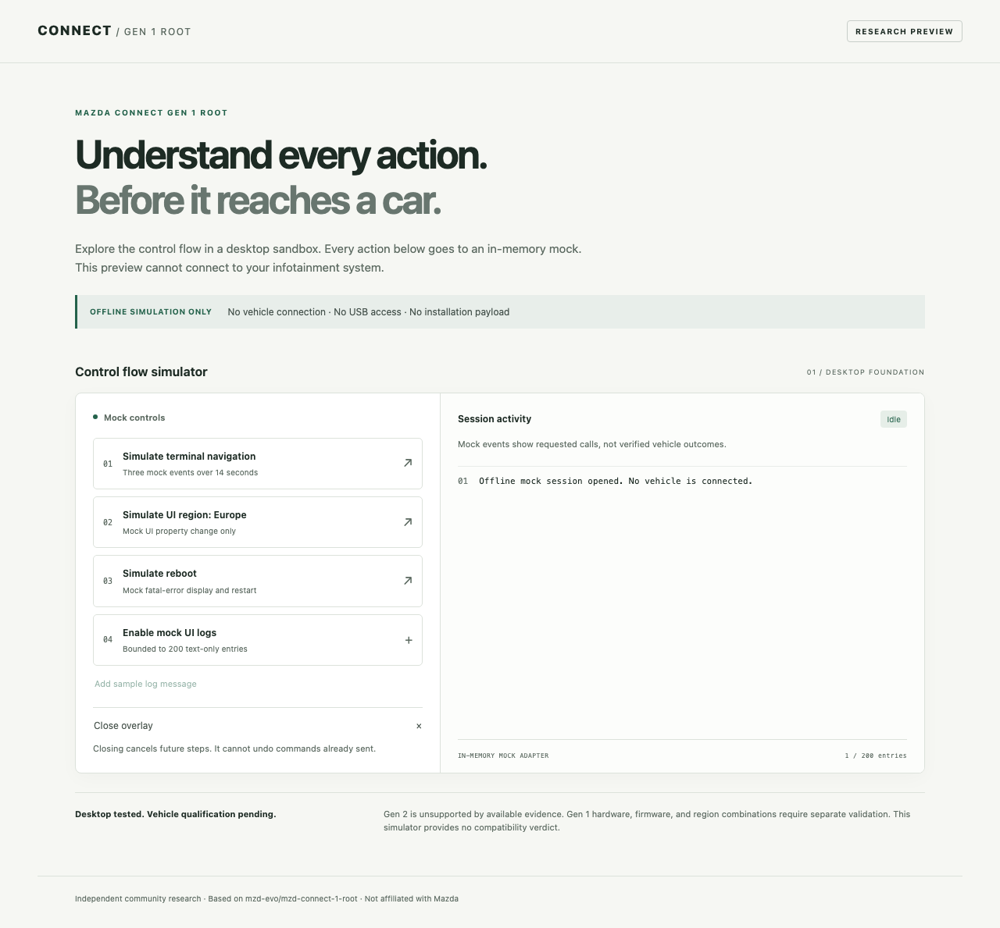
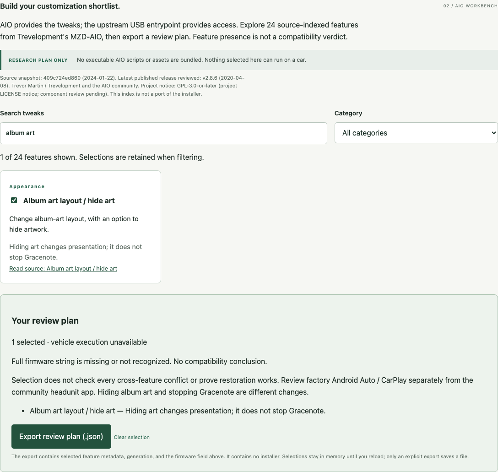
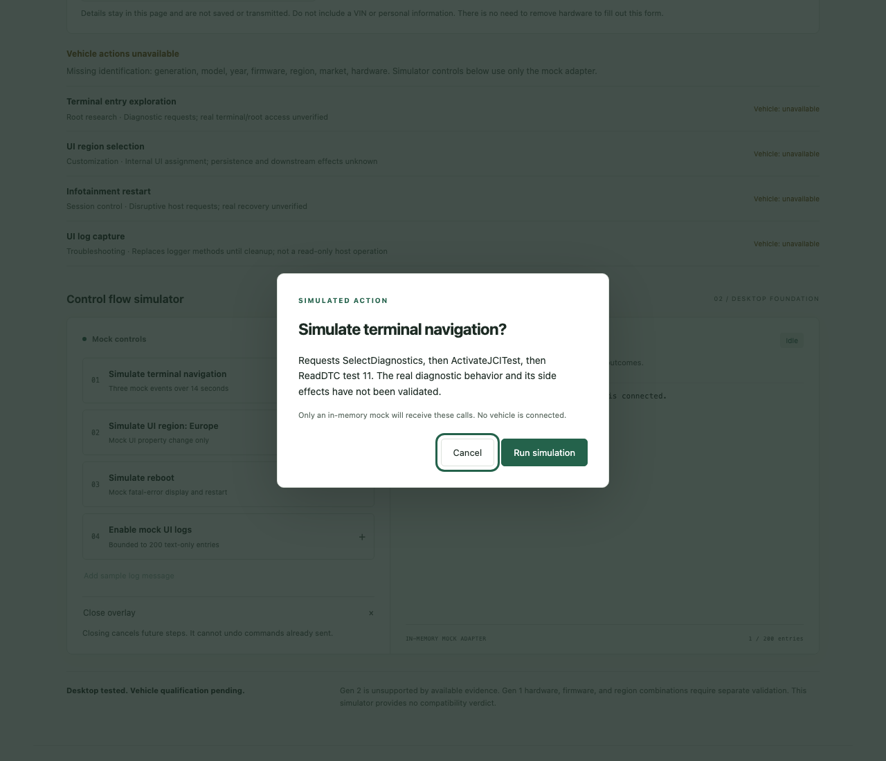

# Mazda Connect Gen 1 Root

**Understand every action before it reaches a car.**

Independent community research into first-generation **Mazda Connect / MZD Connect**, based on [mzd-evo/mzd-connect-1-root](https://github.com/mzd-evo/mzd-connect-1-root).

> **Experimental research — no vehicle-ready release.** This repository retains upstream MP3 files whose title metadata contains active HTML/JavaScript-loading content. They are **not ordinary demo audio**. Do not insert this repository or its MP3 files into a vehicle to preview the simulator. The desktop preview serves only the new simulator assets.



## What this fork adds

- A standalone, clearly labeled **offline simulator**, with an explicit in-memory mock adapter and no vehicle connection.
- Tested control logic: one operation at a time, bounded text-only logs, capability checks, error reporting, and cancellation of pending steps on close.
- An [action reference](docs/actions.md), [compatibility evidence](docs/compatibility.md), and [safety findings](docs/safety-findings.md).
- Automated desktop tests and a SHA-256 integrity check against a pinned upstream commit.
- An [upstream report and regression review](docs/upstream-review.md) and [source-linked architecture analysis](docs/architecture.md), with tests that reproduce seven legacy defects in the actual inherited script.
- An [AIO customization workbench](docs/aio-integration.md): 24 source-indexed features, search/filter/selection, and JSON review-plan export. It does not bundle executable AIO scripts or claim feature compatibility.
- A local target assessment and [shared feature policy](docs/capability-policy.md). Vehicle execution is unavailable for every configuration; the controller permits only explicitly declared mock execution.

These improvements apply to the **new simulator only**. The inherited vehicle-facing code remains unchanged and retains its documented problems. Neither a passing test nor an integrity check establishes that a vehicle operation is safe.

## Preview on your computer

Requires Node.js 22 or newer and npm. After cloning this fork, run these commands in its directory:

```sh
npm ci
npm run preview
```

Open **http://127.0.0.1:4173** in a current desktop browser. Stop the server with Ctrl+C. The server listens only on your computer's loopback interface, serves an explicit list of simulator assets, and does not serve the inherited payload files. There are no external fonts, analytics, remote APIs, or installation steps for a vehicle.

The preview itself works without an internet connection after dependencies are installed. Its native confirmation dialog requires a current desktop browser; this UI is not designed for the vehicle browser.

### Explore AIO customization

Scroll to **AIO workbench**. Search for backgrounds, album art, audio behavior, speedometer or Android Auto; select features and export a JSON review plan. Filters preserve your choices. Source links point to a pinned Trevelopment/MZD-AIO snapshot. Firmware findings explain source limits, including the community video's firmware-74 bypass. Every export is metadata only, with vehicle execution unavailable. The catalog is a first integration slice, not all AIO options or a compiled installer. See the [source review and remaining integration work](docs/aio-integration.md).



### Try the simulated controls

The target-assessment form records generation, model/year, full OS string, region, market, and hardware identification within the page only. Filling it out cannot unlock vehicle actions. Leave unknown fields blank; no hardware removal is needed. The simulator below remains independent of the assessment.

1. Select **Simulate terminal navigation**, read the explanation, and confirm. Three mock events appear over 14 seconds.
2. While it runs, other operations are disabled. **Close overlay** cancels pending steps and moves focus to **Reopen simulator**.
3. Enable mock UI logs and add a sample message. HTML-like content is displayed literally, with at most 200 log entries retained.
4. Try simulated region selection or reboot. Both operate only on the mock; reboot does not reload the page.

**Cancellation cannot undo a command already sent.** The simulator does not model downstream diagnostic behavior, real reboot completion, persistent settings, power loss, or recovery.



## Compatibility and current status

| Target | Evidence | Status |
| --- | --- | --- |
| Desktop simulator | Automated controller and Chromium UI tests; see [validation](docs/validation.md) | Desktop behavior only |
| Gen 1, firmware 70.00.335 on a reported 2020 CX-5 | Upstream community success report | Not independently reproduced |
| Gen 1, firmware 74.00.324 EUN | Upstream community success comment | Not independently reproduced; vehicle unspecified |
| Owner's 2022 MX-5 Miata GT / ND2 | Vehicle reported by owner; firmware and market unconfirmed | No qualification performed |
| Mazda Connect Gen 2 | No supporting evidence in reviewed source | Unsupported by available evidence |

ND2 identifies a Miata revision, not infotainment generation. Identifying Gen 1 alone does not establish compatibility. See the [full evidence table](docs/compatibility.md) before drawing conclusions from model years or anecdotes.

## Development and verification

```sh
npm run check:upstream
npm test
npx playwright install chromium
npm run test:browser
npm run test:upstream
```

CI runs the integrity check, controller/integrity/ES5 syntax tests, Chromium UI tests, and an isolated upstream characterization suite. A passing `LEGACY BUG` test means a known upstream defect was reproduced, not fixed in the inherited payload. Browser installation on Linux CI also installs system dependencies. Read [CONTRIBUTING.md](CONTRIBUTING.md) for boundaries and test expectations.

The upstream baseline is commit [`b1f7a7e082cb88c78183dd94cdb87bd4b02dae60`](https://github.com/mzd-evo/mzd-connect-1-root/commit/b1f7a7e082cb88c78183dd94cdb87bd4b02dae60). The checker validates all nine inherited files against both recorded hashes and that Git commit. It requires Git history containing the commit; use a normal clone or CI's full-history checkout. Source ZIP downloads do not provide that history. The controller and capability policy retain ES5 syntax; the desktop UI still requires modern browser APIs.

## Before vehicle integration

The next gate requires identified hardware, exact firmware and region, a spare infotainment unit with suitable power, an established recovery procedure, and documented bench results for **each** proposed action. Our daily-driver Miata is not the initial test target. No vehicle adapter, qualified configuration profile, installation package, or recovery tool is provided by this milestone.

## Attribution and licensing status

This fork preserves upstream history, files, and existing attribution, including metadata embedded in the original media. No license file was present in the reviewed upstream commit, and GitHub reported no detected license. This milestone assigns no license to upstream material and makes no claim that retaining a public repository establishes broader reuse rights. Licensing clarification remains open before wider distribution.

This is independent community research, not affiliated with or endorsed by Mazda. Names identify the systems being studied. Community interest and repository stars are not compatibility or safety certifications.
