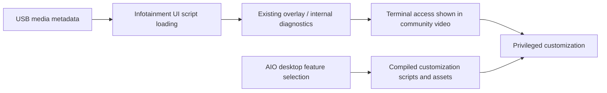

# AIO integration: source review and first desktop slice

Reviewed 2026-10-23. This is the start of a unified root-research and customization app, not an executable AIO bundle. The workbench indexes 24 features, not every AIO option or variant. It does not compile scripts, resolve dependencies, inspect a connected CMU, or validate a car.

## How the pieces fit

This describes the community workflow, not something the desktop workbench executes. The [original project](https://github.com/mzd-evo/mzd-connect-1-root/tree/b1f7a7e082cb88c78183dd94cdb87bd4b02dae60) supplies the metadata/script entrypoint and overlay. It does not contain the complete implementation of the terminal's downstream diagnostic behavior. The [architecture review](architecture.md) explains this boundary.

At a high level, the Gen 1 infotainment unit is an embedded computer. Much of its interface uses web technology. The media-title path allows active markup to reach that interface; the payload then calls its script-loading facility. The overlay uses internal APIs already available in that environment. AIO is a separate project that assembles modifications to interface files, settings and startup code. Access and customization are distinct layers.

Discovering a route like this typically involves reverse engineering firmware, tracing media rendering and internal APIs, and testing assumptions on hardware. We have not found evidence establishing the original author's exact discovery process. The presence of this route does not mean the author invented all of AIO: its installer credits many contributors.

## What the supplied video establishes

The owner supplied a transcript of [Jerry's video](https://www.youtube.com/watch?v=Iha2bl9tWPE), described as published 2024-08-29. We read the transcript; we did not independently observe a vehicle installation or reproduce its result.

The narrator describes a 2018 MX-5, firmware 74 with an NA firmware region despite being in Australia, and AIO 2.8.6. He combines the USB entrypoint with an AIO-generated script and edits the compatibility check to accept firmware 74. He reports only a short period of use. That is a community account of a modified installer on one setup, not support for all versions above 59 or proof for the owner's 2022 MX-5 GT. Firmware conversion, the compatibility bypass, and deployment commands are not implemented here.

## Pinned source review

Source: [Trevelopment/MZD-AIO at 409c724ed860497b2a34f9367cb4a019287846ea](https://github.com/Trevelopment/MZD-AIO/tree/409c724ed860497b2a34f9367cb4a019287846ea), commit dated 2024-01-22; the repository's last push was reported by GitHub as 2024-06-13. The [published v2.8.6 release](https://github.com/Trevelopment/MZD-AIO/releases/tag/v2.8.6) is dated 2020-04-08. A source snapshot and a release are distinct artifacts; we have not established that the installer binaries contain this exact source. No downloaded AIO installer or dependency has been executed.

| Finding | Evidence and implication |
| --- | --- |
| AIO assembles selected pieces into an installer | [build-tweaks.js](https://github.com/Trevelopment/MZD-AIO/blob/409c724ed860497b2a34f9367cb4a019287846ea/app/assets/js/build-tweaks.js) queues the introduction, variables, common functions and selected tweak fragments. Selecting `runsh` changes the output name. Copying a single tweak fragment is not a complete bundle. |
| Firmware 74 is unknown to the pinned checker | [00_start.txt](https://github.com/Trevelopment/MZD-AIO/blob/409c724ed860497b2a34f9367cb4a019287846ea/app/files/tweaks/00_start.txt), `compatibility_check`, recognizes 55, 56, 58, 59 and 70. It rejects a nonzero middle version group. Its executable branch uses 360 for a 70 boundary, while its later warning refers to testing through 352; comments disagree too. Do not turn this into a support claim. |
| USB Audio Mod has its own gate | [26_usbaudiomod-i.txt](https://github.com/Trevelopment/MZD-AIO/blob/409c724ed860497b2a34f9367cb4a019287846ea/app/files/tweaks/26_usbaudiomod-i.txt) runs only below compatibility group 5. The common checker puts 59.00.500 and later into group 5, although user-facing wording says 59.00.502+. The workbench reports the actual gate and does not authorize older versions. |
| Hiding covers differs from stopping Gracenote | [14_bgart-i.txt](https://github.com/Trevelopment/MZD-AIO/blob/409c724ed860497b2a34f9367cb4a019287846ea/app/files/tweaks/14_bgart-i.txt) can append hide-art CSS. [kill_gn.sh](https://github.com/Trevelopment/MZD-AIO/blob/409c724ed860497b2a34f9367cb4a019287846ea/app/files/tweaks/config/disable_gracenote/kill_gn.sh) polls for and terminates a process. Its presence alone does not establish compiler wiring, startup integration or restoration. |
| Community Android Auto modifies more than a screen | [25_androidauto-i.txt](https://github.com/Trevelopment/MZD-AIO/blob/409c724ed860497b2a34f9367cb4a019287846ea/app/files/tweaks/25_androidauto-i.txt) manages processes, application registration, persistent binaries and startup script entries. Factory CarPlay/Android Auto must be considered separately. |
| Some changes require more than an uninstall toggle | [11_msgreplies-i.txt](https://github.com/Trevelopment/MZD-AIO/blob/409c724ed860497b2a34f9367cb4a019287846ea/app/files/tweaks/11_msgreplies-i.txt) explicitly calls for restoring factory settings and edits startup configuration. [18_swapfile-i.txt](https://github.com/Trevelopment/MZD-AIO/blob/409c724ed860497b2a34f9367cb4a019287846ea/app/files/tweaks/18_swapfile-i.txt) enables USB-backed swap and changes startup code. Those effects need individual restoration testing. |

The catalog is a source index with independently written descriptions. A source link proves a feature exists in the snapshot, not that its complete dependency graph, uninstall path or behavior was audited. Common firmware findings describe the common function only; per-feature support remains unresolved.

## Existing AIO reports to investigate

These are selected relevant reports, not an exhaustive issue audit. They are user observations and do not establish a root cause or imply our unchanged inherited payload fixes them.

- [Issue 160](https://github.com/Trevelopment/MZD-AIO/issues/160): desktop 2.8.6 exits after an unhandled JavaScript exception. Our workbench does not embed or launch that Electron application and makes no startup network requests. We have not repaired AIO's installer.
- [Issue 174](https://github.com/Trevelopment/MZD-AIO/issues/174): a 2017 Yaris iA owner reports a black screen and then loss of interface input after several tweaks and an attempted community Android Auto launch. The reporter suspects Android Auto; causality is unconfirmed.
- [Issue 222](https://github.com/Trevelopment/MZD-AIO/issues/222): an owner reports losing wireless CarPlay after AIO changes on a reported 74.xx.331 build. This is a reason to test existing projection features explicitly; it is not proof that every AIO tweak causes that fault.

## What is implemented

The local workbench searches and filters a pinned 24-feature catalog, retains selections across filters and overlay reopen, displays firmware findings, links to exact source files, and exports a JSON review plan. Plans always say `executable: false` and `vehicleAllowed: false`. Gen 2 stays unsupported. Source files, shell fragments, binaries, installer assets and commands are absent from the export. There is no plan import or execution path.

Choices remain in memory. Explicit export saves selected metadata plus generation and the entered firmware string; model, market, hardware identifier and other target fields are excluded. Search input is used as text, not markup or regular expressions. Source pages open externally only when the user follows a link.

## Path to an executable bundle

1. Port the compilation model into separately reviewable feature packs: explicit inputs, complete source/asset manifests, target files and mutations, prerequisites, storage requirements, conflicts and restoration behavior. Begin with appearance and audio presentation; qualify process/startup modifications and community apps separately.
2. Verify exact artifact versions and per-component redistribution terms before vendoring any code, fonts, images or binaries. Preserve contributor notices and provide the required source/license materials for whatever is distributed.
3. Establish each pack's hardware/firmware test matrix, backup and recovery procedure on a suitable spare CMU. Check existing camera, audio, calls and factory phone projection before and after each change, including interruption and restoration behavior.
4. Connect qualified packs to an explicit vehicle adapter only in a later reviewed milestone. The existing desktop policy grants no such access, and a manually edited firmware check cannot qualify a pack.

This first slice does not bundle AIO executables. The remaining work is actual feature-pack compilation, dependency/license review and bench qualification; a selection screen alone does not complete that integration.

## Attribution and license boundaries

AIO's [project LICENSE notice](https://github.com/Trevelopment/MZD-AIO/blob/409c724ed860497b2a34f9367cb4a019287846ea/LICENSE) identifies Trevor Martin / Trevelopment and GPL version 3 or later. Its package metadata says GPL-3.0. Individual components and assets still require review. This milestone contains source references and original catalog descriptions, not copied AIO scripts or assets. It does not apply AIO's license to the original root repository, where no license was found, or resolve that separate upstream reuse question.
