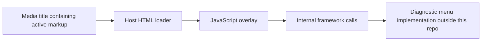

# Mazda Connect architecture: evidence and engineering consequences

Reviewed 2026-10-23. This is a research model, not documentation of a supported Mazda API. Hardware findings from another unit are not measurements of the owner's 2022 MX-5 GT.

## What the available sources establish

Mazda's [2022 MX-5 announcement](https://news.mazdausa.com/2021-12-16-2022-Mazda-MX-5-Miata-Pricing-and-Packaging) identifies a seven-inch Mazda Connect touchscreen with Commander controls and smartphone integration. Its [owner's manual](https://www.mazdausa.com/static/manuals/2022/mx-5/contents/06110205.html) describes touch restrictions while driving and distinguishes Gracenote media-database updates from other system behavior. Neither provides the internal JavaScript API contract used by this repository.

Mazda's [2018 technical review, page 57](https://www2.mazda.com/ja/technology/gihou/2018/wbbook/pageindices/index64.html) describes the CMU and a revised USB hub for CarPlay. It also discusses memory/CPU constraints and coordinating smartphone-projection input. Adding CarPlay therefore does not establish that a unit belongs to the newer infotainment generation. The interface must respect resource limits and existing input restrictions.

### Hardware security boundary

[ZDI's 2024 primary research](https://www.zerodayinitiative.com/blog/2024/11/7/multiple-vulnerabilities-in-the-mazda-in-vehicle-infotainment-ivi-system) examined a Visteon/JCI Gen 1-family CMU on firmware 74.00.324A. It describes a Linux application processor and an auxiliary controller associated with vehicle-network connectivity. The demonstrated security weaknesses could cross that partition. The researchers did not investigate specific vehicle-control impacts. This is evidence against assuming infotainment compromise is inherently isolated; it is not a compatibility test of this repo or the owner's car.

This diagram summarizes the studied unit only. No vehicle-network code, firmware flashing, or controller modification is implemented here.

## What this repository actually does

The following path is directly observable in the pinned upstream source, rather than inferred from the hardware study:

- `sendEventToMmui` sends requests into host modules. The repo supplies no acknowledgement contract, readiness signal, or downstream implementation. A request recorded by a test double does not prove a real diagnostic action completed.
- `ReadDTC` with test ID 11 is a request name and argument. Calling it read-only, harmless, or a verified root operation would require evidence that is absent here.
- `_restartCMU` and `_showFatalErrorWink` are internal methods, not documented supported interfaces. Their existence and effects must be qualified per target.
- `_currentRegion` is an internal UI assignment. No persistent region conversion or radio-frequency change is established by this source.
- Closing the overlay removes DOM elements. It does not reverse a diagnostic command already dispatched or restore an unknown downstream menu setting.

The desktop controller deliberately records mock requests only. Its fixed delays demonstrate the original sequence; they are not a substitute for a real completion/readiness contract.

## Distinguishing an upstream regression from a vehicle fault

Mazda's historical [software bulletin MC-10226834](https://static.nhtsa.gov/odi/tsbs/2022/MC-10226834-0001.pdf) includes 2016–2023 MX-5 among applicable vehicles, with market/model limits for other vehicles. Its version history documents pre-existing blank/frozen displays, reboots, and camera-display issues. This establishes alternative fault categories, not the cause of an upstream reporter's incident. The bulletin also warns about customization and firmware rollback limitations; we do not offer a firmware update or rollback procedure here. Version descriptions in a 2022 bulletin are not a claim about the newest software today.

For an incident, preserve the exact firmware/region, hardware identification if known, pre-existing modifications, last requested action, whether audio/Commander/camera functions remain available, and the complete sequence of observed changes. Do not infer that replacing a screen was necessary merely because a report mentions a dealership recommendation. Do not reproduce a reported diagnostic-menu action on a daily driver to investigate it.

## Consequences for implementation

1. Keep the device adapter and installation path disconnected until an exact configuration and recovery method are bench-qualified. No fake compatibility success based on model year, display size, or a version prefix.
2. Preserve source logger behavior: receiver, all arguments, return value, and original exceptions. Capturing a log must not break the source function when formatting or rendering fails.
3. Treat cleanup as best effort in a shared host. Do not overwrite a method another component replaced. Failure to restore one property must not prevent timer invalidation or cleanup of the remaining methods.
4. Fail closed when observation/rendering fails: invalidate pending work and keep an inspectable error snapshot. Closing must remain closed even if a late adapter failure occurs.
5. Bound retained messages and mock history. Keep keyboard/Commander design and driving restrictions in the qualification requirements; a modern desktop dialog does not prove embedded-browser or Commander compatibility.

## Still unknown

Exact firmware, region, and hardware revision of the owner's car; downstream diagnostic test behavior; application privilege level for this loading path; persistence of changes; full recovery; interrupted-power behavior; compatibility with Gen 2; and the causes of the upstream display reports. None becomes resolved by passing desktop tests.
